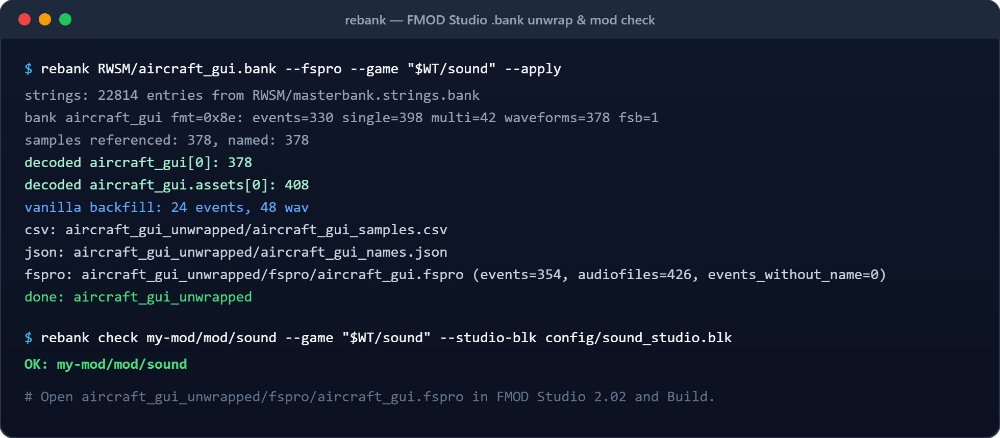
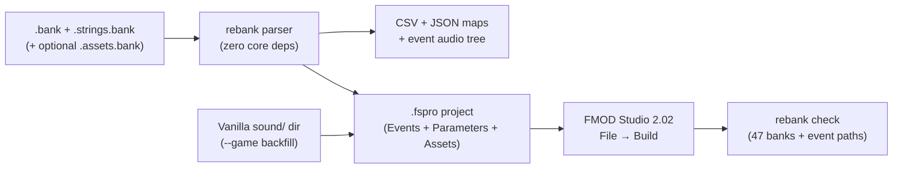

<div align="center">

# ReBank

**Turn compiled FMOD Studio `.bank` files back into named audio samples and an editable `.fspro` project.**

[](https://github.com/fuckula/rebank/actions/workflows/ci.yml)
[](https://github.com/fuckula/rebank/releases/latest)
[](https://github.com/fuckula/rebank/releases)
[](https://pyproject.org)
[](LICENSE)

[Install](#install) · [Usage](#usage) · [Modding Guide](docs/MODDING_GUIDE.md) · [Game Sound Reference](#game-sound-reference) · [Architecture](docs/ARCHITECTURE.md)



</div>

> [!NOTE]
> The FMOD binary format analysis, parser, and War Thunder game sound reference tables were created with AI coding assistance and verified against the **Sky Odyssey** client (`FMOD Studio 2.02.22`).

Compiled `.bank` files strip human names down to binary GUIDs and packed `FSB5` sample indices (`sound_0`, `sound_1`, …). ReBank resolves the full reference chain (`strings.bank` → `EVTB` → track → `WAIT`/`MUIT` → `WAVS` → `FSB5`), maps every audio file to its `event:/...` path, fills empty mod slots from the game's vanilla banks (`--game`), generates an editable FMOD Studio `2.02` `.fspro` project, and validates built mod folders against `aces.exe` loading rules.



---

## Install

### Windows standalone executable (recommended for modders)

Download `rebank.exe` from [GitHub Releases](https://github.com/fuckula/rebank/releases/latest). Built with `fsb5`, `libogg.dll`, and `libvorbis.dll` bundled inside — runs vanilla `.bank`/`.assets.bank` decoding without a Python install.

### From source / Python (`>= 3.10`)

```sh
# Zero-dependency core (name maps, renaming, diff, init, check, catalog)
pipx install git+https://github.com/fuckula/rebank.git

# With built-in FSB5 Vorbis/FADPCM audio decoding (for --fspro / --game)
pipx install "rebank[decode] @ git+https://github.com/fuckula/rebank.git"
```

Or run directly from a local clone without installing:

```sh
git clone https://github.com/fuckula/rebank.git
cd rebank
pip install -e ".[decode]"   # omit [decode] for pure-stdlib mode
rebank --version
```

> [!TIP]
> Decoding compressed **Vorbis** samples into `.wav` assets inside `.fspro` also requires [`ffmpeg`](https://ffmpeg.org/) on `PATH` and `libogg.dll`/`libvorbis.dll` (`bin/` in this repo handles Windows automatically).

---

## Usage

### A. Generate an editable `.fspro` from a mod bank (with vanilla backfill)

Many War Thunder sound mods leave untouched events empty inside their custom `.bank`. Passing `--game` pulls those missing or empty events (including nested parameter sheets) straight from your game install so the rebuilt bank stays complete.

```sh
# bash
WT="C:/Program Files (x86)/Steam/steamapps/common/War Thunder"
rebank "RWSM/aircraft_gui.bank" \
  --fspro --game "$WT/sound" \
  --rename-dir "fsb_0_wavs" --apply
```

```powershell
# PowerShell
$WT = "C:\Program Files (x86)\Steam\steamapps\common\War Thunder"
rebank "RWSM\aircraft_gui.bank" `
  --fspro --game "$WT\sound" `
  --rename-dir "fsb_0_wavs" --apply
```

ReBank automatically looks for `masterbank.strings.bank` next to the input bank (override with `-s`), detects split `<name>.assets.bank` files, or accepts pre-decoded WAV folders via `--rename-dir` (repeat `--rename-dir` per FSB chunk `[0]`, `[1]`, …). Without `--rename-dir`, `--fspro` decodes embedded `FSB5` samples directly when `rebank[decode]` is available.

### B. Unwrap a split vanilla bank (`X.bank` + `X.assets.bank`)

Modern War Thunder clients place metadata in `<name>.bank` and audio payloads in `<name>.assets.bank`:

```sh
rebank "$WT/sound/aircraft_gui.bank" \
  -a "$WT/sound/aircraft_gui.assets.bank" \
  --fspro -o aircraft_gui_project
```

Open `aircraft_gui_project/fspro/aircraft_gui.fspro` in **FMOD Studio 2.02**, edit or swap audio files, and build with `File → Build`.

### C. Validate a built mod folder before shipping

War Thunder disables the **entire** mod silently if a single required bank is missing:

```sh
rebank check "$WT/sound/mod/my_mod" \
  --game "$WT/sound" \
  --studio-blk "unpacked/config/sound_studio.blk"
```

### D. Scaffold a new mod workspace from Gaijin's official project

```sh
rebank init my-mod --game "$WT/sound"
```

Clones [`fmod_studio_warthunder_for_modders`](https://github.com/GaijinEntertainment/fmod_studio_warthunder_for_modders) (`2.02.22`) alongside a ready-to-validate `mod/sound` directory.

### E. Generate or update the game events catalog

```sh
# Writes docs/EVENTS.md index + grouped tables under docs/events/*.md
rebank catalog "$WT/sound" --csv events.csv
```

### F. Check a mod after a game update (`--diff`)

```sh
rebank "my_mod/sound/aircraft_gui.bank" --diff "$WT/sound"
```

Lists events added or removed by the patch so you know which banks need a rebuild.

<details>
<summary>CLI options & output directory layout</summary>

```text
rebank BANK.bank [options]
  -s, --strings PATH       *.strings.bank (default: masterbank.strings.bank next to bank)
  -a, --assets PATH        paired X.assets.bank (split-bank layout)
  -o, --out DIR            output root (default: <bank>_unwrapped)
  --csv PATH               sample -> events CSV (default: <out>/<bank>_samples.csv)
  --json PATH              name map JSON (default: <out>/<bank>_names.json)
  --rename-dir DIR         folder of sound_N.wav|ogg (repeat per FSB: [0], [1], ...)
  --fsb-dir DIR            dump raw embedded .fsb chunks
  --fspro                  generate FMOD Studio 2.02 project (<out>/fspro/<bank>.fspro)
  --game DIR               backfill missing/empty mod events from vanilla sound/ dir
  --game-wav DIR           pre-extracted vanilla sound_N.wav|ogg folders (skip decode)
  --diff DIR               compare events against vanilla sound/ dir
  --apply                  copy/rename --rename-dir files into <out>/<event_path>/
  -V, --version            show version and exit

Subcommands:
  rebank init DEST [--reference DIR] [--game DIR] [--no-clone]
  rebank check MOD_DIR --game DIR [--studio-blk FILE]
  rebank catalog GAME_DIR [-o OUT] [--csv CSV] [--split] [--split-dir DIR]
```

```text
<out>/
├── <bank>_samples.csv         # (fsb, sample_index, waveform_guid, events)
├── <bank>_names.json          # "0_12" -> ["event:/..."]
├── _audio/                    # decoded bank FSB samples (when --fspro decodes directly)
├── _game_audio/               # decoded vanilla samples (when --game is used)
├── _from_vanilla/             # wavs copied for backfilled vanilla events
├── _unmatched/                # samples without a named event in strings.bank
├── <event/folder/...>.wav     # renamed sample tree (created with --rename-dir --apply)
└── fspro/
    ├── <bank>.fspro           # open in FMOD Studio 2.02
    ├── Assets/                # audio assets mapped to event folders
    └── Metadata/              # Event, AudioFile, ParameterPreset, Bank XMLs
```

</details>

---

## Modding Rules at a Glance

Read the full [**Sound Modding Guide**](docs/MODDING_GUIDE.md) before packaging a mod. Four rules prevent silent load failures in `aces.exe`:

1. **Ship all 47 required banks** in `sound/mod/<your_mod>/` (`masterbank*`, `aircraft_*`, `tanks_*`, `ships_*`, plus `.assets.bank` pairs) — a single missing required bank turns the entire mod off silently.
2. **Never rename or move paths** — event paths, filenames, mixer buses, and game parameters are addressed literally by C++ and `.blk` files.
3. **Pair `.bank` and `.assets.bank` from the same Studio build** — FMOD generates fresh waveform GUIDs on every build, so mixing halves leaves events silent.
4. **Validate before release** with `rebank check --game "$WT/sound" --studio-blk config/sound_studio.blk`.

---

## Game Sound Reference

Complete lookup tables extracted from the **Sky Odyssey** client archives (`wt_ext_cli`) and FMOD banks (`rebank catalog`).

| Guide / Reference | Scope | Link |
| --- | --- | --- |
| **Docs Hub** | Pipeline diagram, quick recipes, table directory | [`docs/README.md`](docs/README.md) |
| **Sound Modding Guide** | Game loading gates, split pairs, backfill workflow, RWR swaps | [`docs/MODDING_GUIDE.md`](docs/MODDING_GUIDE.md) |
| **Bank Architecture** | `RIFF/FEV`, `STDT` trie, `EVTB`, `PMLB`, `EVIS`, `.fspro` XML spec | [`docs/ARCHITECTURE.md`](docs/ARCHITECTURE.md) |
| **Events Catalog** | **139 banks** (59 populated, 80 empty/assets), **16,457 named events** + params (split into [`docs/events/*.md`](docs/EVENTS.md)) | [`docs/EVENTS.md`](docs/EVENTS.md) |
| **Sound Event References** | **1,898 events** across 29 banks mapped to `.blk`/`.das` fields + 44 preset fields | [`docs/SOUND_REFS.md`](docs/SOUND_REFS.md) |
| **Aircraft** | **1,547** flight models (RWR, sensors, alarms, engines, guns) | [`docs/AIRCRAFT.md`](docs/AIRCRAFT.md) |
| **Helicopters** | **119** helicopters (RWR, sensors, alarms, engines, guns) | [`docs/HELICOPTERS.md`](docs/HELICOPTERS.md) |
| **Tanks** | **1,483** ground vehicles (engines, tracks, turrets, backfire) | [`docs/TANKS.md`](docs/TANKS.md) |
| **Ships** | **756** naval vessels (engines, wakes, turrets) | [`docs/SHIPS.md`](docs/SHIPS.md) |
| **Vehicle Weapons** | **3,905** vehicles → mounted sounding weapons (split into [`docs/vehicle_weapons/*.md`](docs/VEHICLE_WEAPONS.md)) | [`docs/VEHICLE_WEAPONS.md`](docs/VEHICLE_WEAPONS.md) |
| **Weapons** | **2,883** weapon configs (`sound`, `sound_inside`, guidance, launch, paths) | [`docs/WEAPONS.md`](docs/WEAPONS.md) |

---

## Technical Scope & Limitations

- **Verified against:** War Thunder **Sky Odyssey** (`FMOD Studio 2.02.22`, bank format `0x8E`), real split `.bank`/`.assets.bank` pairs, Gaijin's reference workspace, and synthetic regression suites (`tests/`).
- **What ReBank preserves:** Event GUIDs and full `event:/...` folder paths, `WAIT` single instruments and `MUIT` playlists in original track order, `EVTB[0x5D]` / `PMLB` parameter sheets (including nested multi-layer proxies), `LISTEVIS` nested child events, and decoded `.wav` assets with true converted duration and rate metadata.
- **What ReBank does not reconstruct:** Custom mixer return routing (`_headphones` buses flatten to Master Bus), DSP effect chains (`3D Spatializer`, `Multiband EQ`, automation curves), scatterer spawn parameters (`SPIB`), and FMOD `2.00` or `2.03` bank layouts outside `0x8C`–`0x8E`. For heavy mixer effects on existing vanilla/modded buses, start from `rebank init` (Gaijin's official project).

---

## Contributing & License

Contributions, bug reports, and format findings from other FMOD `2.02` builds are welcome. See [`CONTRIBUTING.md`](CONTRIBUTING.md), [`CODE_OF_CONDUCT.md`](CODE_OF_CONDUCT.md), and [`SECURITY.md`](SECURITY.md).

Licensed under the [MIT License](LICENSE). Third-party binary redistribution notices live in [`NOTICE`](NOTICE).
