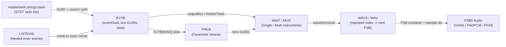

[← Docs](README.md) · [Modding Guide](MODDING_GUIDE.md) · [Contributing](../CONTRIBUTING.md)

# ReBank Architecture & FMOD 2.02 Bank Layout

Technical specification for contributors working on `parse_bank`, `parse_strings_bank`, `read_array`, or `generate_fspro` in [`rebank.py`](../rebank.py). Offsets and serialization rules were verified against FMOD Studio `2.02.22` (`fmt=0x8C`–`0x8E`).

## End-to-End Resolution Chain



## 1. Binary Array Encoding (All Nested Arrays)

Every nested array inside `EVTB`, `PMLB`, and `STDT` (except the `STDT` string pool length and tail tables) uses the same layout:

1. `varint n`: `u16` (if bit `0x8000` is set, read a second `u16` and combine `(w & 0x7FFF) | (w2 << 15)`), then `count = n >> 1`.
2. **One** `u16 elemSize` written **once** for the entire array (never per element).
3. `count × elemSize` raw payload bytes.

> [!WARNING]
> Reading `elemSize` before every element instead of once per array silently mis-aligns all subsequent fields in `EVTB`, `PMLB`, and `STDT`. See `read_array()` in [`rebank.py`](../rebank.py).

## 2. Strings Bank (`STDT` inside `LIST/PROJ`)

Layout inside `masterbank.strings.bank`:

```text
[u32 version]
[array(n, es=8) nodes]        # two u32s: v1 = strOff (u24), v2 = guidIdx (u24) | childCount << 24 (0xFFFFFF = none)
[array(g, es=16) guids]       # 16-byte raw little-endian GUIDs
[u16 strPoolLen][pool bytes]  # plain u16 (NOT shifted varint!)
[u16 mc][mc × 3B guid->node]  # plain u16, 24-bit indices
[u16 pc][pc × 3B parent]      # plain u16, 24-bit parent indices (0xFFFFFF = root)
```

Note that `strPoolLen`, `mc`, and `pc` are the **only** places in the format using a plain `u16` instead of a shifted varint. `tests/test_primitives.py` constructs a synthetic `STDT` bank against this exact layout.

## 3. Event Body (`EVTB`)

| Offset | Field | Notes |
| --- | --- | --- |
| `0x00` | `eventGuid` | 16-byte GUID (little-endian `Data1/Data2/Data3`) |
| `0x10` | `timelineGuid` | 16-byte GUID |
| `0x20` | `outputBus` | Primary instrument track GUID (`WAIT.tg` / `MUIT.tg`) |
| `0x30` | `inputBus` | 16-byte GUID |
| `0x40` | `masterTrack` | Fallback track owner GUID |
| `0x50` / `0x54` | `maxInstances` / `stealing` | `u32` |
| `0x59` | `priority` | `u32` (unaligned) |
| `0x5D` | `slot` array | `read_array` of 16-byte `PMLB` owner GUIDs (parameter sheets) |

> [!NOTE]
> `LISTEVTS` shares entries with `snapshot:/...`, buses, and banks. `generate_fspro()` filters strictly on `strings[e].startswith('event:/')` so snapshots do not become empty `Event` objects.

## 4. Parameter Sheets (`PMLB`) & Nested Events (`LISTEVIS`)

* **`LISTPRMS / PARM / PRMB`:** stores `paramGuid` (`[:16]`), `u16` name length (`[24:26]`), UTF-8 parameter name, and `(min, max, default)` floats.
* **`LISTPMLS / PMLO / PMLB`:** `owner16 + paramGuid16 + array(items, 16)`. Items reference `WAIT.ig`, `MUIT.guid` / `MUIT.tg`, or scatterer `SPIB`. Multiple slots on one event may drive different parameters, and multiple `PMLB` records can share one parameter.
* **`LISTEVIS / EVIT`:** `EVIB[16:32]` is the inner target event GUID, and `INST[0:16]` is the outer track/timeline GUID. ReBank credits unnamed inner events to their outer named event (`event_owners()`).

## 5. Waveform Descriptors (`LISTWAVS` / FourCC `'WAV '`) & FSB5 Containers

* Each `'WAV '` record stores `guid` (`[0:16]`), `flags` (`u32`), `index = u32 >> 16` (`[20:24]`), `field`, and `sub`.
* **Multi-FSB indexing:** when sample index `k` repeats in serialization order across `'WAV '` records, the `i`-th occurrence belongs to the `i`-th embedded `FSB5` container (`SNDH` table).
* **Split banks (`X.bank` + `X.assets.bank`):** metadata and event structures live in `X.bank`, while waveform sample indices and `FSB5` containers live in `X.assets.bank`. Both halves are merged by waveform GUID (`merge_split_wavs()`).

## 6. FMOD Studio 2.02 `.fspro` XML Invariants

FMOD Studio 2.02 (`serializationModel="Studio.02.02.00"`) rejects generated projects with `"incomplete or malformed components"` if object relationships violate Studio's ownership graph:

1. **GUID byte order:** raw 16-byte binary GUIDs use Microsoft mixed-endian (`<IHH` + 8 raw bytes). `guid_str()` must decode `Data1`, `Data2`, `Data3` little-endian to match Studio XML and `strings.bank`.
2. **`ParameterProxy.preset` target:** must point to the `GameParameter` GUID inside `Metadata/ParameterPreset/*.xml`, **never** to the `ParameterPreset` GUID itself (Studio drops the proxy on load if aimed at the preset).
3. **Track ownership:**
   * Plain track modules sit on both `Timeline.modules` and one `GroupTrack` (`"Audio 1"`), leaving `MasterTrack` empty.
   * Parameter sheet modules sit on both `ParameterProxy.modules` (as `MultiSound`) and per-sheet `GroupTrack` (`"layer00"`, `"layer01"`, ...).
4. **Asset tree:** every folder under `Assets/` needs a corresponding `EncodableAsset` XML under `Metadata/Asset/` or Studio displays an empty asset browser.
5. **Formatting:** XML elements without children must be self-closing (`<object ... />`) with clean newline separation.

## 7. Facts (Not Parser Bugs)

* `WAIT.tg == 0` instruments belong to parameter sheets (`PMLB`), not timeline tracks.
* Parent placeholder events with zero instruments (such as empty RWR parents or unpopulated mod slots) have nothing playable in the bank itself and are intentionally filled from vanilla when `--game` is provided.
* Studio assigns brand-new waveform GUIDs on every build (0 waveform GUIDs shared with vanilla), which is why rebuilt `.bank` and `.assets.bank` halves must always ship as a matched pair.
