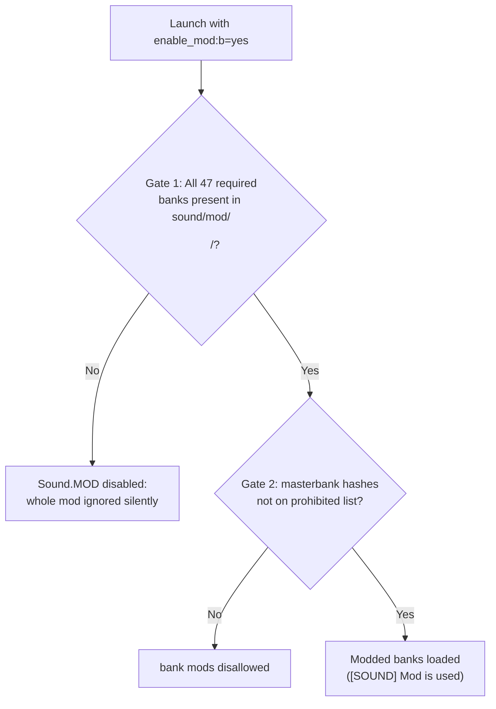

[← Docs](README.md) · [README](../README.md) · [Events Catalog](EVENTS.md)

# War Thunder Sound Modding Guide

Tested recipes for building working War Thunder sound mods — and the exact game-engine failures each rule prevents. Verified against the **Sky Odyssey** client (`FMOD Studio 2.02.22`) by binary analysis, bank parsing, and full Studio builds.

`$WT` below refers to your War Thunder installation directory (`.../War Thunder`).

## Contents

- [1. Ship a Complete Mod Folder (All 47 Required Banks)](#1-ship-a-complete-mod-folder-all-47-required-banks)
- [2. Keep Every Event Name, Path, Bank Name, and Bus Unchanged](#2-keep-every-event-name-path-bank-name-and-bus-unchanged)
- [3. Always Ship Split Pairs Together](#3-always-ship-split-pairs-together)
- [4. Rebuilding a Bank from the Game with ReBank](#4-rebuilding-a-bank-from-the-game-with-rebank)
- [5. Changing Samples Without Touching the Metadata Bank](#5-changing-samples-without-touching-the-metadata-bank)
- [6. Updating a Mod After a Game Patch](#6-updating-a-mod-after-a-game-patch)
- [7. Pre-Release Checklist](#7-pre-release-checklist)



---

## 1. Ship a Complete Mod Folder (All 47 Required Banks)

**Rule.** `sound/mod/<your_mod>/` must contain **every** bank listed in `config/sound_studio.blk` (`banks → presets → master`) that does not have `optional:b=true` — **47 banks** in the Sky Odyssey build:

- `masterbank`, `masterbank.strings`, `masterbank.assets`
- every `aircraft_*`, `tanks_*`, `ships_*` metadata bank and its `.assets` pair

Only `dialogs*`, `crew_dialogs_common*`, `football*`, `event*`, and `event_tgw*` are optional.

> [!CAUTION]
> **Partial mod folders are disabled silently.** On the very first missing required bank, the game switches the **entire mod** off (`Sound.MOD disabled: modded bank is missing: ...`) and falls back to vanilla audio everywhere. Nothing appears in the game UI, and `.game_logs/*.clog` files are encrypted. Never distribute a mod folder containing only a single modified `.bank`.

**Recipe.**

1. Copy all untouched vanilla banks into your mod folder first:

   ```sh
   # bash
   mkdir -p "$WT/sound/mod/my_mod"
   cp "$WT/sound/"*.bank "$WT/sound/mod/my_mod/"
   ```

   ```powershell
   # PowerShell
   New-Item -ItemType Directory -Force "$WT\sound\mod\my_mod" | Out-Null
   Copy-Item "$WT\sound\*.bank" "$WT\sound\mod\my_mod\"
   ```

2. Overwrite only the bank pairs you rebuilt ([both halves](#3-always-ship-split-pairs-together)).
3. Enable mods in `$WT/config.blk`:

   ```text
   sound{
     fmod_sound_enable:b=yes
     enable_mod:b=yes
   }
   ```

4. Validate completeness and event paths before sharing:

   ```sh
   rebank check "$WT/sound/mod/my_mod" --game "$WT/sound" \
       --studio-blk /tmp/wt_aces/aces.vromfs.bin_u/config/sound_studio.blk
   ```

   (`/tmp/wt_aces` comes from `wt_ext_cli unpack_vromf -i "$WT/aces.vromfs.bin" -o /tmp/wt_aces --format BlkText`.) Even without `--studio-blk`, `rebank check` warns when a metadata `.bank` is missing its paired `.assets.bank`.

---

## 2. Keep Every Event Name, Path, Bank Name, and Bus Unchanged

**Rule.** Event names, paths (`event:/aircraft/gui/alarm_radar_an_alr_56`), bank filenames, mixer bus hierarchy, and game-driven parameters (`track`, `volume`, `on_shot`, …) must match the game exactly. Change the *content* inside events, never their identity.

**Failure it prevents.** The engine triggers events by path and feeds parameters by name; a renamed event or missing parameter is ignored without warning.

**Recipe.**

- Start new projects from Gaijin's official [`fmod_studio_warthunder_for_modders`](https://github.com/GaijinEntertainment/fmod_studio_warthunder_for_modders) (FMOD Studio **2.02.22**) using `rebank init my-mod`.
- For events omitted from Gaijin's reference project (such as all 24 RWR `alarm_radar_*` tones, localized dialogs, `infantry_*`, and `football`), rebuild from the vanilla bank instead ([§4](#4-rebuilding-a-bank-from-the-game-with-rebank)).
- `rebank check` exits non-zero if any expected event is missing or renamed.

---

## 3. Always Ship Split Pairs Together

**Rule.** Every rebuilt bank outputs two files: `<name>.bank` (metadata: events, instruments, parameter sheets) and `<name>.assets.bank` (sample audio). The master bank also writes `masterbank.strings.bank`. This matches FMOD Studio's *"Build metadata and assets to separate banks"* setting.

> [!WARNING]
> **Never mix a Studio-built `.assets.bank` with a vanilla `.bank` (or vice versa).** FMOD Studio generates brand-new waveform GUIDs on every build (`0` GUIDs shared with vanilla). Mixing halves from different builds resolves zero samples and makes every event silent.

**Recipe.** After `File → Build` in FMOD Studio, copy **both** `<name>.bank` and `<name>.assets.bank` from `Build/sound/` into your mod folder alongside the untouched vanilla banks.

---

## 4. Rebuilding a Bank from the Game with ReBank

**Recipe.**

```sh
rebank "$WT/sound/aircraft_gui.bank" -a "$WT/sound/aircraft_gui.assets.bank" \
    --fspro -o my_project --apply
```

1. Open `my_project/fspro/aircraft_gui.fspro` in **FMOD Studio 2.02.22**, replace or edit audio inside events, and run `File → Build`.
2. ReBank preserves event GUIDs, paths, game parameters, and original samples. Note that mixer routing is flattened to the master bus, so for events relying on custom mixer returns (e.g. `_headphones`), prefer starting from Gaijin's official project.

**Verify before shipping:**

```sh
rebank check Build/sound --game "$WT/sound"
```

If running from a source checkout, you can also validate generated `.fspro`/built XML integrity with:

```sh
python smoke_test.py Build/sound/aircraft_gui.bank "$WT/sound"
```

> [!TIP]
> **Known Studio serialization behavior (harmless):** `SingleSound` instruments placed on parameter sheets are serialized by FMOD Studio as one-entry `MultiSound` containers (`537/167` vs `475/35` in vanilla `aircraft_gui`). Playback behavior in-game is identical.

---

## 5. Changing Samples Without Touching the Metadata Bank

**When to use.** You want to keep the vanilla `<name>.bank` metadata untouched and swap individual samples inside `<name>.assets.bank` (for example, replacing F-15/Eurofighter RWR tones with F-16 tones). FMOD Studio cannot produce a drop-in `.assets.bank` alone because rebuilding assigns new waveform GUIDs ([§3](#3-always-ship-split-pairs-together)).

**Rule.** Keep the `WAVS` table (`waveform GUID → sample index`) intact, and when patching an entry inside the `FSB5` container, copy the donor's **entire sample header** (sample rate, channel count, sample count, Vorbis codebook CRC) together with its audio payload, then update the `SNDH` table and FSB header sizes (`sampleHeadersSize` / `dataSize`).

**Failure it prevents.** Copying only payload bytes while keeping the original sample header corrupts decoding (for example, vanilla `aircraft_gui` mixes 48 kHz and 16 kHz Vorbis samples using different codebooks). This is a manual/custom binary-patching technique rather than a built-in ReBank command.

---

## 6. Updating a Mod After a Game Patch

When War Thunder updates:

1. Re-copy untouched vanilla banks into your mod folder ([§1](#1-ship-a-complete-mod-folder-all-47-required-banks)) so newly added required banks are not missing.
2. Check which events were added or removed since your bank was built, and re-verify your mod folder:

   ```sh
   rebank my_mod/sound/aircraft_gui.bank --diff "$WT/sound"
   rebank check my_mod/sound --game "$WT/sound" --studio-blk <sound_studio.blk>
   ```

3. Rebuild your edited bank(s) against the new vanilla pair ([§4](#4-rebuilding-a-bank-from-the-game-with-rebank)).

---

## 7. Pre-Release Checklist

- [ ] `sound/mod/<folder>/` holds all 47 required banks (`rebank check --studio-blk` → `OK`)
- [ ] Every rebuilt bank ships both `<name>.bank` and `<name>.assets.bank` from the same Studio build
- [ ] No Studio-built `.assets.bank` is paired with a vanilla `.bank`
- [ ] Event names, paths, bank names, and parameters are unchanged (`rebank check` → `OK`)
- [ ] `config.blk` includes `enable_mod:b=yes` inside `sound{}`
- [ ] Tested in-game: target events play the modified audio
