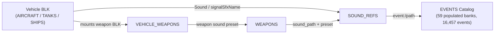

# ReBank Documentation

Complete technical guides and War Thunder FMOD Studio reference tables (verified on **Sky Odyssey**, FMOD Studio **2.02.22**, bank format `0x8E`).

## How the Game Audio Pipeline Connects

## Guides & Architecture

| Document | Audience | Contents |
| --- | --- | --- |
| [**Sound Modding Guide**](MODDING_GUIDE.md) | Mod authors | Rules enforced by `aces.exe`, the 47 required banks, split `.bank`/`.assets.bank` pairs, vanilla backfill, assets-only RWR swaps, release checklist |
| [**Architecture & Bank Format**](ARCHITECTURE.md) | Contributors | Binary layout (`RIFF/FEV`, `STDT` radix trie, `EVTB`, `PMLB`, `EVIS`, `WAVS`), array varint encoding, and FMOD Studio 2.02 `.fspro` XML invariants |

## Game Sound Reference Tables

All reference tables are extracted from unpacked game archives (`wt_ext_cli`) and FMOD `.bank` files (`rebank catalog`).

| Catalog | Rows | Size & Scope |
| --- | ---: | --- |
| [**Events Catalog (`EVENTS.md`)**](EVENTS.md) | 16,457 | Index + 7 split group files (`docs/events/*.md`) covering all 139 banks (59 populated, 80 empty/assets-only) and their game parameters |
| [**Sound Event References (`SOUND_REFS.md`)**](SOUND_REFS.md) | 1,898 | Maps `event:/...` paths across 29 banks back to `.blk`/`.das` config fields and 44 unresolved native preset fields |
| [**Aircraft (`AIRCRAFT.md`)**](AIRCRAFT.md) | 1,547 | Per flight model: RWR indicator, sensors, `signalSfxName` alarms, engine, gun, turret, nozzle presets |
| [**Helicopters (`HELICOPTERS.md`)**](HELICOPTERS.md) | 119 | Per helicopter flight model: RWR, sensors, alarms, engine, gun, turret presets |
| [**Tanks (`TANKS.md`)**](TANKS.md) | 1,483 | Per ground vehicle: engine, AI engine, tracks, turret/gun turn, backfire presets |
| [**Ships (`SHIPS.md`)**](SHIPS.md) | 756 | Per vessel: engine, AI engine, wake/track, turret turn presets |
| [**Vehicle Weapons (`VEHICLE_WEAPONS.md`)**](VEHICLE_WEAPONS.md) | 3,905 | Index + 4 split category files (`docs/vehicle_weapons/*.md`) listing sounding weapons mounted per vehicle |
| [**Weapons (`WEAPONS.md`)**](WEAPONS.md) | 2,883 | Per weapon block: fire, interior, cockpit/outside/AI, charge, reload, guidance, launch, and `sound_path` |

## Quick Lookups

- **Want to replace an RWR / radar warning tone?** Look up the aircraft's RWR event in [AIRCRAFT.md](AIRCRAFT.md), inspect its parameters in [`events/aircraft.md`](events/aircraft.md), and follow the split-bank workflow in [MODDING_GUIDE.md](MODDING_GUIDE.md).
- **Want to change a specific tank gun or missile sound?** Find the vehicle's mounted weapons in [`vehicle_weapons/tanks.md`](vehicle_weapons/tanks.md) or [`vehicle_weapons/aircraft.md`](vehicle_weapons/aircraft.md), then look up the weapon's `sound` and `sound_path` in [WEAPONS.md](WEAPONS.md).
- **Want to regenerate these tables after a War Thunder patch?** See the `rebank catalog` and `scripts/*.py` instructions in the [root README](../README.md#game-sound-reference).
